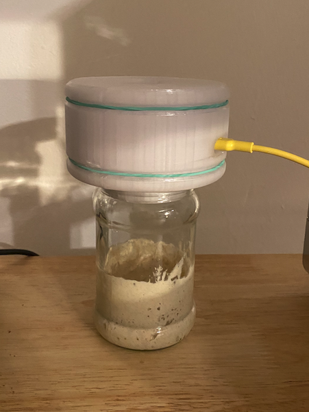
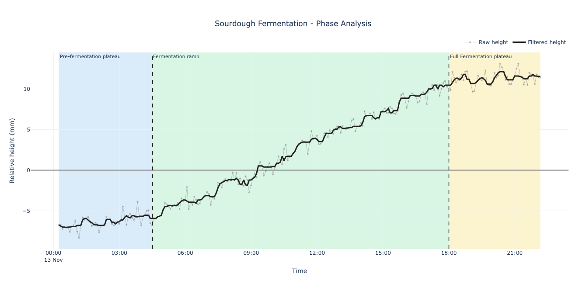
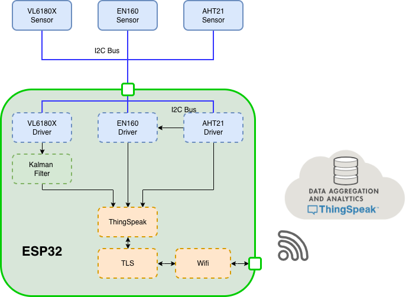
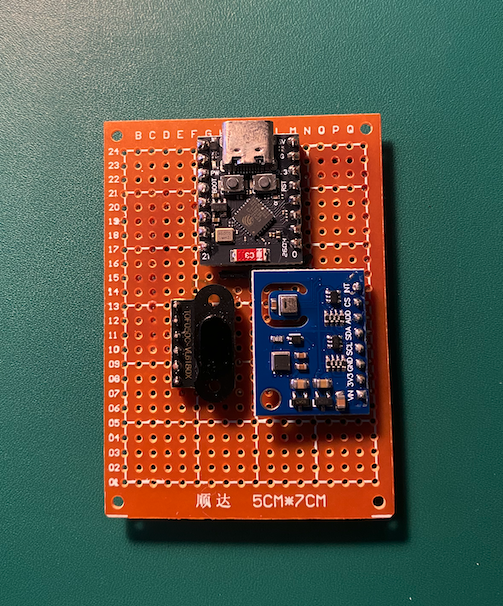
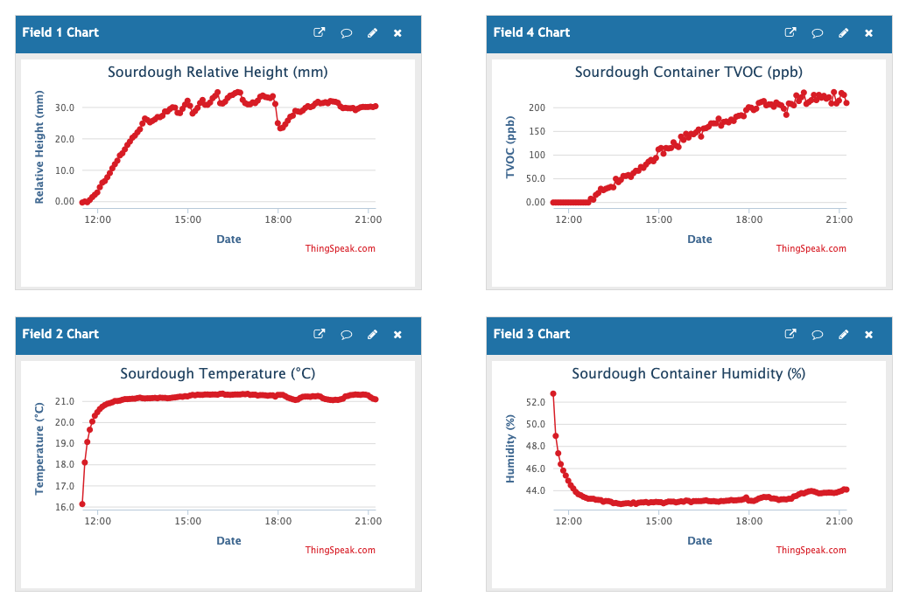
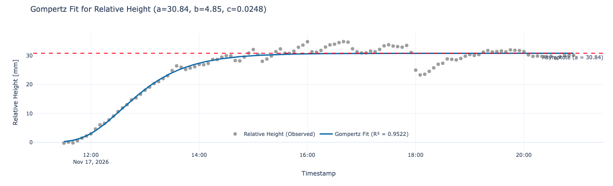
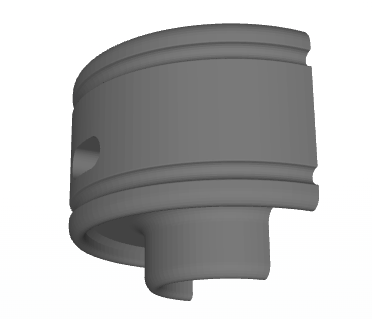

# Sourdough IoT Monitor

An experimental IoT and data-analysis platform for monitoring sourdough fermentation, understanding starter activity, and investigating ways to predict its peak.

The project uses an **ESP32-C3** microcontroller and three sensors to collect physical and environmental measurements during sourdough fermentation. Measurements are sent to [ThingSpeak](https://thingspeak.com/) for storage and further analysis.

The long-term goal is to combine changes in sourdough height with environmental and activity-related indicators to better understand fermentation dynamics, characterize different fermentation profiles, and investigate how to identify the optimal time to use a sourdough starter.

<p align="center">
  
  
</p>

> **Project status:** Functional prototype collecting real-world data. Data analysis and fermentation modelling are ongoing research activities.

## Table of Contents

- [Sourdough IoT Monitor](#sourdough-iot-monitor)
  - [Table of Contents](#table-of-contents)
  - [Overview](#overview)
  - [Embedded System Architecture](#embedded-system-architecture)
  - [Hardware](#hardware)
    - [Hardware schematics](#hardware-schematics)
    - [I²C Communication](#ic-communication)
  - [Firmware](#firmware)
    - [Firmware modules](#firmware-modules)
    - [Sensor acquisition](#sensor-acquisition)
  - [Data Collection](#data-collection)
    - [ThingSpeak channel fields](#thingspeak-channel-fields)
  - [Data Analysis](#data-analysis)
  - [Mechanical Design](#mechanical-design)
  - [Getting Started](#getting-started)
    - [Requirements](#requirements)
    - [Clone the repository](#clone-the-repository)
    - [Configure local credentials](#configure-local-credentials)
    - [Build the firmware](#build-the-firmware)
    - [Flash the board](#flash-the-board)
  - [Security](#security)
    - [Credentials](#credentials)
    - [HTTPS and certificate verification](#https-and-certificate-verification)
  - [License](#license)

## Overview

Sourdough fermentation is a dynamic biological process influenced by several interacting factors, including temperature, humidity, microbial activity, and feeding conditions.

A starter's height is a useful indicator of fermentation progress, but height alone does not necessarily describe its biological activity or maturity.

This project explores a multi-sensor approach to monitoring sourdough fermentation:

- **Physical measurements:** tracking changes in starter height over time.
- **Environmental measurements:** monitoring temperature and relative humidity.
- **Activity-related measurements:** collecting total volatile organic compounds (TVOC) using an air-quality sensor.

By collecting these measurements simultaneously, the project aims to investigate possible relationships between physical expansion, environmental conditions, and fermentation activity.

Ultimately, the objective is to develop a mathematical model capable of describing fermentation behaviour, identifying different fermentation profiles, and helping estimate when a starter reaches its peak activity.

These objectives are still under investigation. The current firmware collects the measurements but does not yet implement a validated peak-prediction model.

## Embedded System Architecture

The project is organized into separate modules for sensor acquisition, filtering, network connectivity, and cloud communication.



## Hardware

### Hardware schematics

The electronics part is pretty straightforward. The electronics components are connected in the following way:

<p align="center">
  
  
</p>

### I²C Communication
The firmware uses the following sensor addresses:

| Sensor | I²C address |
|---|---|
| VL6180X | `0x29` |
| ENS160 | `0x53` |
| AHT21 | `0x38` |

## Firmware
The firmware running on the ESP32 is written completely in Rust. It uses mainly `esp-hal` and some `embassy` crates for the network interface. Since I could not found a suitable crate for the Time-of-Flight sensor, I just implemented the basic functionality for this project under [vl6180x.rs](/src/sensors/vl6180x.rs). For the other sensors (ENS160 and AHT21) I was able to use off-the-shelf crates.
The main challenge for the firmware was to implement the TLS module. During TLS handshake I had many failures due to insufficient heap memory. After many tries I was able to find a suitable value, but this might require some attention if new features are added to the firmware later.

### Firmware modules

| Module | Responsibility |
|---|---|
| `src/sensors/` | Sensor drivers, initialization, and measurement acquisition |
| `src/filters/` | Signal filtering algorithms |
| `src/network/` | Wi-Fi and network management |
| `src/cloud/` | TLS configuration and ThingSpeak communication |
| `src/bin/main.rs` | Application initialization and main measurement loop |

The implementation uses Rust's `no_std` environment and the Embassy asynchronous framework.

### Sensor acquisition

The three sensors are initialized on a shared I²C bus.

The measurement sequence is:

1. Read temperature and humidity from the AHT21.
2. Apply temperature and humidity compensation to the ENS160.
3. Read the ENS160 measurements, including TVOC.
4. Read the VL6180X distance measurement.
5. Calculate relative height and apply Kalman filtering (see more [here](src/sensors/README.md)).
6. Store the latest successful measurement set.


## Data Collection

The firmware uses two different intervals:

| Operation | Interval |
|---|---:|
| Sensor sampling | 30 seconds |
| ThingSpeak upload | 5 minutes |

At each sampling interval, the firmware attempts to acquire a new set of measurements.

At each upload interval, it sends the latest successfully acquired measurement set to ThingSpeak.

This means that intermediate measurements are not individually uploaded. The cloud dataset contains one measurement set approximately every five minutes, rather than every thirty seconds.

If no valid measurements have been acquired, the upload is skipped.

### ThingSpeak channel fields

The current channel uses four fields:

| Field | Measurement | Unit |
|---|---|---|
| Field 1 | Relative height | mm |
| Field 2 | Corrected temperature | °C |
| Field 3 | Relative humidity | % |
| Field 4 | TVOC | ppb |

ThingSpeak provides cloud storage and visualization, allowing measurements to be inspected over time and exported for further analysis.



Please note that if you want to build and use this system you will need to create your own account on ThingSpeak. Considering the amount of data and the upload frequency of this project a free account is more than enough.

## Data Analysis

The `data_analysis/` directory contains experimental datasets, Python scripts, and Jupyter notebooks.

The analysis environment is based on Python and Jupyter notebooks.

The current experiments focus on:

- Visualizing sourdough height changes over time.
- Identifying growth and decline phases.
- Evaluating the effect of filtering on distance measurements.
- Comparing height and TVOC time series.
- Investigating possible relationships between environmental measurements and fermentation behaviour.

The datasets are experimental observations from a specific setup. Results may vary with starter composition, feeding ratio, flour, hydration, ambient conditions, and measurement geometry.

The Python environment is managed by the `uv` tool. To activate the python environment use `$ source .venv/bin/activate`.

An interesting research direction that is currently being pursued consists of fitting a Gompertz curve to different growth profiles and understanding how environmental factors correlate with the parameters of the fitted curve. Another idea is to relate the measured TVOC to height to detect the peak without relying on height measurements.


**This is a working in progress.**

## Mechanical Design 
To ensure a proper mechanical assembly**,** a housing was designed and 3D printed. It encloses the PCB and provides stable support above the sourdough**,** minimizing environmental interference. However, it is recommended to place the system inside a closed**,** thermally insulated space to obtain more accurate measurements.



## Getting Started

### Requirements

The project currently targets the ESP32-C3 and uses the Rust embedded ecosystem.

You will need:

- An ESP32-C3 development board.
- The VL6180X, AHT21, and ENS160 sensors.
- A computer running macOS, Linux, or Windows.
- Git.
- Rust and Cargo.
- The Rust toolchain specified by `rust-toolchain.toml`.
- The `riscv32imc-unknown-none-elf` compilation target.
- `espflash` for flashing the firmware.
- A Wi-Fi network.
- A ThingSpeak account and channel with a write API key.

### Clone the repository

```bash
git clone https://github.com/matheusbortoloti/sourdough_iot_monitor.git
cd sourdough_iot_monitor
```

### Configure local credentials

Create the local configuration file:

```text
.cargo/esp-config.toml
```

Add the following configuration, replacing the placeholders with your own values:

```toml
[env]
WIFI_SSID = "YOUR_WIFI_NAME"
WIFI_PASSWORD = "YOUR_WIFI_PASSWORD"
THINGSPEAK_WRITE_API_KEY = "YOUR_THINGSPEAK_WRITE_API_KEY"
```

This file is intentionally excluded from version control.

The repository's `.cargo/config.toml` includes it automatically during compilation.

### Build the firmware

Build the release firmware:

```bash
cargo build --release
```

### Flash the board

Connect the ESP32-C3 board over USB and execute:

```bash
cargo run --release
```

The configured Cargo runner invokes `espflash` and starts the serial monitor.

The flashing runner is configured for the ESP32-C3 in `.cargo/config.toml`.

> The exact installation and toolchain setup may depend on the Rust toolchain and ESP development environment specified by `rust-toolchain.toml`.

## Security

Security is an important design consideration, particularly because the firmware connects to a Wi-Fi network and uploads data to a cloud service.

### Credentials

Wi-Fi credentials and the ThingSpeak write API key are supplied through local compile-time environment configuration.

They are not hardcoded in the Rust source files.

The local `.cargo/esp-config.toml` file must never be committed to version control.

**Important:** Compile-time environment variables are embedded into the resulting firmware binary. Anyone who obtains the binary may potentially extract the credentials. Treat firmware binaries as sensitive artifacts and avoid distributing them if they contain personal credentials or private API keys.

### HTTPS and certificate verification

Communication with ThingSpeak uses HTTPS over TLS.

The firmware includes the DigiCert Global Root G2 CA certificate:

```text
certs/digicert_global_root_g2.pem
```

The TLS client configuration:

- Requires certificate authentication.
- Specifies `api.thingspeak.com` as the expected server hostname.
- Does not disable hostname verification.

This allows the TLS client to validate the server certificate chain and hostname rather than accepting an unverified connection.

## License

This project is distributed under the MIT License. See [LICENSE](LICENSE) for details.
