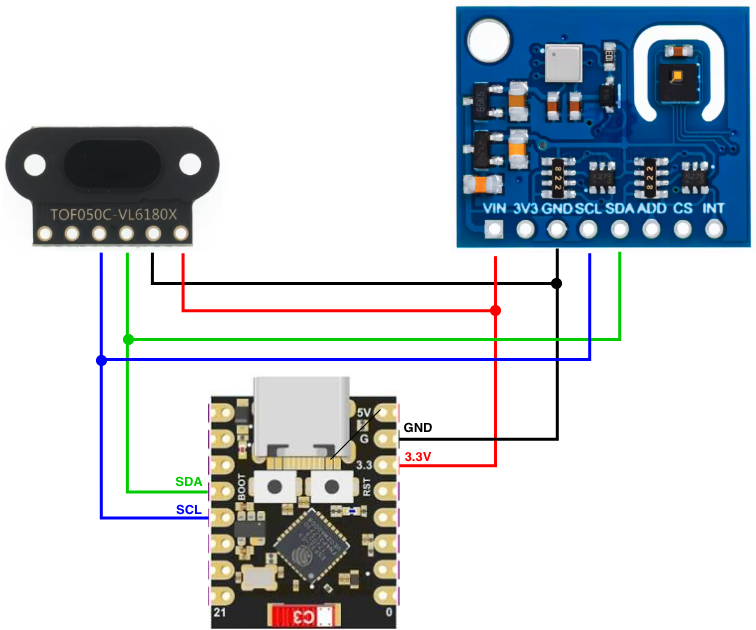

# IoT Sourdough Monitor




Repository structure

```
sourdough_monitor/
│
├── .cargo/
│   └── config.toml
│
├── src/
│   ├── bin/
│   │   └── main.rs
│   │
│   ├── sensors/
│   │   ├── mod.rs
│   │   ├── aht21.rs
│   │   ├── ens160.rs
│   │   └── vl6180x.rs
│   │
│   ├── network/
│   │   └── mod.rs
│   │
│   └── lib.rs
│
├── .gitignore
├── Cargo.lock
├── Cargo.toml
├── LICENSE
└── README.md
```

# I2C Architecture

```
ESP32-C3
   |
   | I2C Controller
   |
   +---- VL6180X driver
   |
   +---- ENS160 driver
   |
   +---- AHT21 driver
```

## Security and Configuration

### Wi-Fi Credentials

Wi-Fi credentials are managed through a local Cargo configuration file rather than being hardcoded into the Rust source code.

The project uses the following arrangement:

- `.cargo/config.toml` includes a separate local configuration file.
- `.cargo/esp-config.toml` stores the Wi-Fi SSID and password.
- Cargo exposes these values as environment variables during compilation.
- The Rust application accesses them at compile time without containing the actual credentials in its source code.

**Security considerations:**

- `.cargo/esp-config.toml` is excluded through `.gitignore` and must never be committed to the repository.
- The repository does not contain real Wi-Fi credentials.
- Developers must create their own local configuration file before building the firmware.
- The compiled firmware necessarily contains the credentials required to connect to the configured Wi-Fi network. Protect firmware binaries accordingly.

A local configuration file can be created using the following template:

```toml
[env]
WIFI_SSID = "YOUR_WIFI_NAME"
WIFI_PASSWORD = "YOUR_WIFI_PASSWORD"
```

This approach separates private configuration from version-controlled source code and reduces the risk of accidentally publishing network credentials.
__Developers must create their own local credentials file and that it must never be committed.__

DigiCert Global Root G2
SHA-256 certificate fingerprint:
CB:3C:CB:B7:60:31:E5:E0:13:8F:8D:D3:9A:23:F9:DE:47:FF:C3:5E:43:C1:14:4C:EA:27:D4:6A:5A:B1:CB:5F