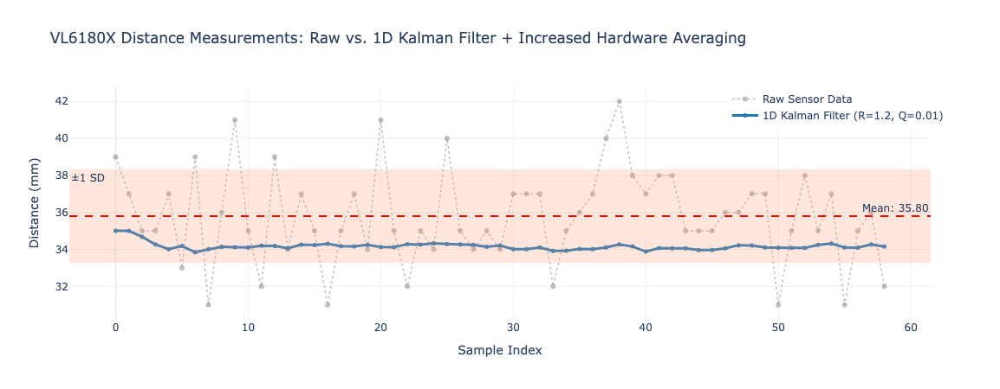

# Sensors

## VL6180X

This Time-of-Flight (TOF) sensor has a lot of noise. Only using the standard sensor configurations and no filtering does not yield good results.
In order to compensate this high noise we adjust the sensor configurations and also implement some digital filtering on the ESP32:

1. **Increase Readout Averaging:** the internal register `READOUT__AVERAGING_SAMPLE_PERIOD (0x10A)` has a default value of 48, which corresponds to 4.3 ms.
We can increase this value up to 255 to tell the sensor to use more samples for a single shot measurement. 
2. **One-dimensional Kalman Filter**: since we can calculate the measurement noise from the raw measurements, we can parametrize a 1D Kalman filter to remove this noise from the measurement data.

In order to estimate the measurement noise, a static distance of aroud 34 mm has been measured multiple times.
The table bellow shows quantitatively the improvements obtained with the actions described above.

|  Filtering Mode                                             | Mean (mm)                      | Standard Deviation (mm)       |
| :---------------------------------------------------------- | :----------------------------: | :---------------------------: | 
| $\color{red}{\text{Raw Measurements}}$                      | $\color{red}{\text{35.80}}$    | $\color{red}{\text{2.54}}$    | 
| $\color{orange}{\text{Increased Averaging}}$                | $\color{orange}{\text{34.14}}$ | $\color{orange}{\text{1.14}}$ | 
| $\color{green}{\text{Increased Averaging + Kalman Filter}}$ | $\color{green}{\text{34.14}}$  | $\color{green}{\text{0.11}}$  | 

The picture bellows shows graphically the improvement obtained between the raw data and the data with increased averaging plus the Kalman filter.

#### Reference establishment

At startup, the firmware collects 60 distance measurements, approximately one second apart.

These measurements are processed by a 1D Kalman filter to establish the reference distance. The filter is then reset before normal measurement acquisition begins.

### AHT21: temperature and humidity

The AHT21 provides temperature and relative humidity measurements.

The current implementation applies an empirical temperature offset correction:

$$T_{corrected} =T_{raw} - 15^\circ\mathrm{C}$$

This correction was determined experimentally for the current hardware setup.

Two temperature values are retained:

- Raw temperature, used for ENS160 environmental compensation.
- Offset-corrected temperature, uploaded to ThingSpeak.

The distinction is intentional: the temperature near the sensor and the ESP32-C3 board can differ from the ambient environment surrounding the sourdough.

The correction is experimental and has not yet been established as a generally valid calibration.

### ENS160: TVOC measurements

The ENS160 provides air-quality measurements, including total volatile organic compounds (TVOC).

Before reading the measurements, the firmware supplies temperature and humidity compensation values obtained from the AHT21.

The raw AHT21 temperature is used for this compensation because the ENS160 requires information about the local sensor environment.

TVOC measurements are collected as a possible indicator of changes in the sourdough's surrounding environment.

Their relationship with fermentation activity is still being investigated. TVOC should not be interpreted as a direct or validated measurement of microbial activity.